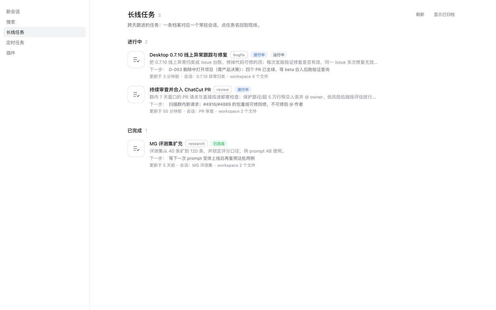
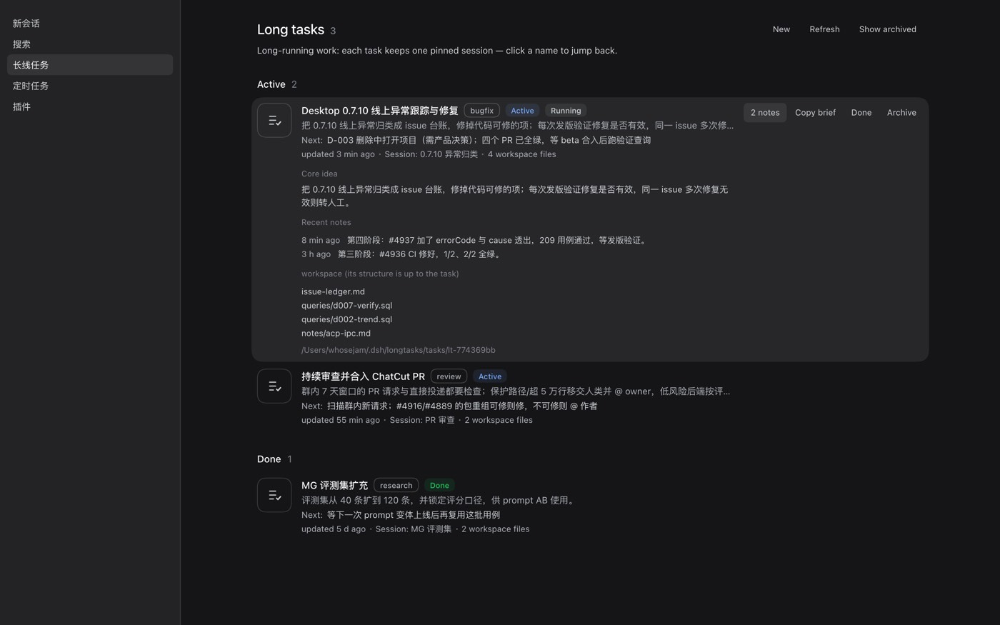
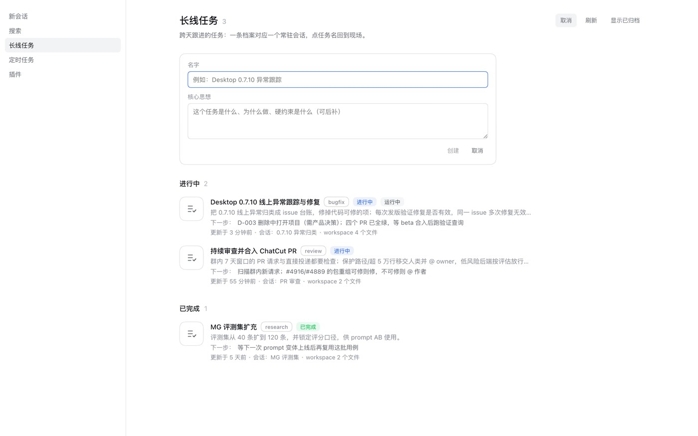
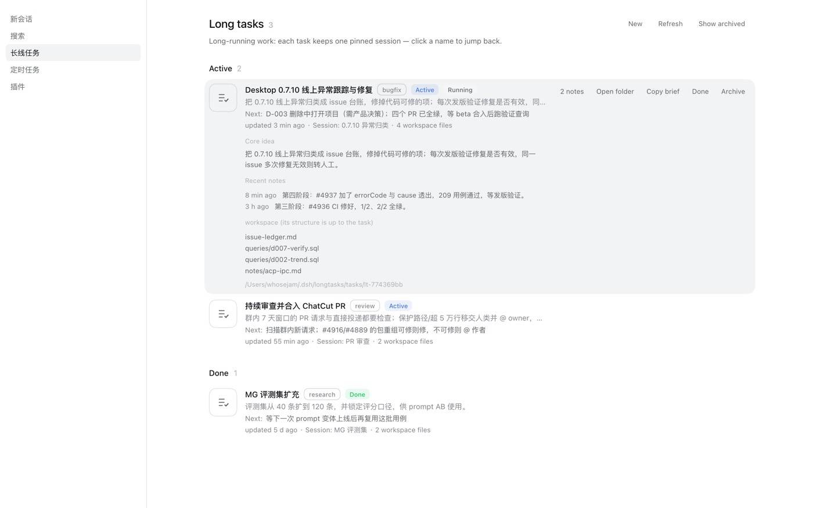
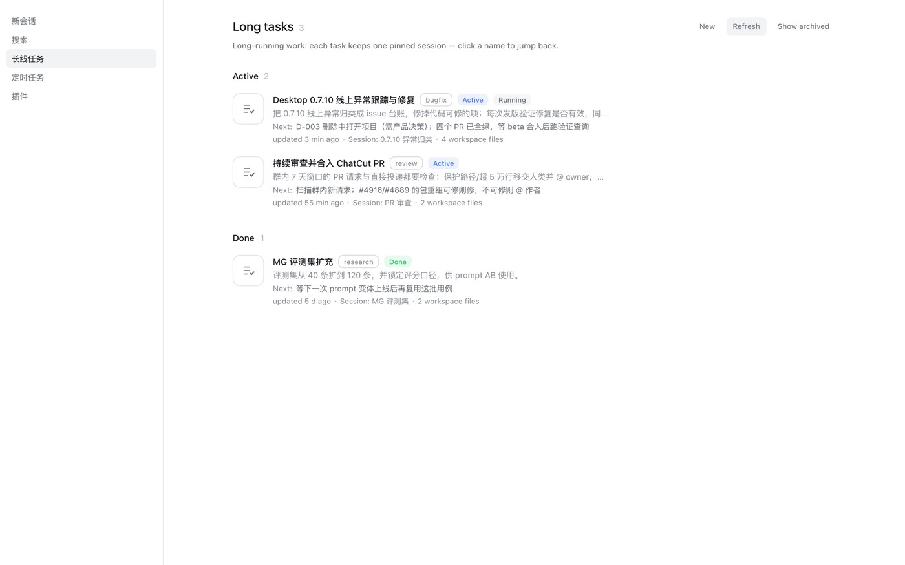

# dsh-longtasks

[](https://github.com/whoseJam/dsh-longtasks/actions/workflows/ci.yml)
[](https://www.npmjs.com/package/dsh-longtasks)
[](https://www.npmjs.com/package/dsh-longtasks)

长线任务花名册 —— 让跨天、跨会话的长期任务在 DSH 里有一个固定身份，而不是每天早上重新解释一遍。

## English summary

A long-running-task roster for DeepSeek Harness. Each long task gets **one directory** —
`TASK.md` holds the stable core idea (brief) plus a stage-level log, and every other file in
that directory is a free-form workspace the agent organizes itself. The plugin does not impose
a structure; it provides identity, a pinned session, an index, a handoff brief, and a
`longtask` tool plus `/longtask` command. A sidebar panel lists tasks and jumps back to the
session that owns one.

## 它解决什么

一个长线任务往往持续若干天：它有自己的目标、进展、卡点、下一步，还有一个「负责它的会话」。
但会话列表是按时间排的，隔天重开电脑以后：找不到那个会话了，只能开新会话让新 AI 重新熟悉任务；
也说不清每个 agent 到底在负责什么。

这个插件把这类任务固定成**一个目录**：

```
~/.dsh/longtasks/<id>/
├── TASK.md          # 档案：核心思想 + 下一步 + 工作记录（插件维护这几节）
├── issue-ledger.md  # ↓ 以下全部由这个任务自己决定
├── queries/*.sql
└── notes/…
```

两层要分清：

- **brief（核心思想）**：稳定、短。这个任务是什么、为什么做、硬约束是什么。写在 `TASK.md` 里。
- **workspace**：活的工作区。修 bug 的放台账和验证查询，PR 审查的放队列和结论，调研的放假设和实验。
  插件**不解析**这里的内容，也不规定结构——agent 用普通文件工具自己组织。

## 给模型什么

1. **`longtask` 工具**：`create` / `list` / `show` / `update` / `note` / `handoff` / `archive` / `delete`（`brief` 是 `handoff` 的旧名）。
   `create` 会分配任务目录并返回 workspace 路径；`show` 直接返回 `TASK.md` 原文，
   于是 agent 想怎么改档案结构都行（插件只重写 frontmatter 和「核心思想 / 工作记录」两节）。
2. **系统提示注入**：每个新会话开工时，提示里就带着花名册——状态、核心思想的下一步、workspace 路径，
   标 ★ 的是本会话负责的条目，超 3 天没动的会挂 `⚠️ 已 N 天未更新`。
3. **`/longtask` 命令**：不经过模型也能查和改。

```
/longtask                       列出全部
/longtask note <id> <一行结论>   记一条阶段性结论
/longtask done|waiting|active|archive <id>
/longtask handoff <id>           取交接简报（含 workspace 文件清单；brief 为旧名）
/longtask bind <id>              把任务绑到当前会话（面板新建的任务用它补绑定）
/longtask show <id>             打印 TASK.md 原文
/longtask new <名字>            以当前会话新建
```

## 工作原则

插件不规定 workspace 的结构（修 bug 的台账、PR 审查的状态机、调研的实验记录，形状本来就不同），
但下面几条是共同的，会被注入到每个长线任务会话的系统提示里：

1. **状态归任务自己**：台账、结论、脚本放这个任务的 workspace（`~/.dsh/longtasks/<id>/`），不要放共享 skill 目录或别人的仓库目录。
2. **不要放进 worktree 或临时目录**：git worktree、`/tmp`、缓存目录只放构建、试跑、验证这类一次性产物，随时可删，不能当唯一真相。
3. **brief 只写稳定的核心思想**（是什么、为什么、硬约束）；进度和结论用 `longtask note`，一轮工具调用不值得记。
4. **workspace 结构自己定**，但要让接手的人一眼找到「当前状态」和「下一步」。
5. **TASK.md 是索引不是仓库**：核心思想、下一步、最近 1-3 条一行结论留在里面，别的都出去。
6. **长记录按逻辑拆，不按日期堆**：每个线索/问题一个文件（`topics/<slug>.md`），决策与理由进 `decisions.md`，可复用步骤进 `runbook.md`，当前在办的事进 `ledger.md`，再写一个 `README.md` 列清每个文件是什么；同一类内容先并进已有文件，不要一件事一个文件。

`longtask` 会机械化地提醒这两种情况：单条 `note` 超过 5000 字 → "细节写进主题文件"；记录已超过 8 条而 workspace 还不到 3 个文件 → "建议按线索拆成 `topics/<slug>.md` + `README.md`"。

一个长任务的 workspace 通常长这样：

```
TASK.md          核心思想 + 下一步 + 最近结论
README.md        每个文件是什么、当前状态
ledger.md        在办事项清单
topics/d-007-*.md 单条线索的来龙去脉
decisions.md     决策与理由
runbook.md       可复用的步骤
```
7. **依赖外部资产**（worktree 池、缓存、外部仓库）时，在 brief 里写明路径，交接时才找得回来。

### 用户提醒的兜底

原则靠自觉，所以加了一层机械兜底：用户在**绑定了长线任务的会话**里说了像纠正/约束/决定的话
（命中「不要 / 应该 / 必须 / 记住 / 以后 / 记得 / 规则…」这类信号），插件把这句记成"待落库提醒"，
**下一轮系统提示**里点名：

```
## 待落库的用户提醒（记进「…」后本节自动消失）
- 2026-10-20 12:04 用户：以后任务状态不要放进 worktree
处理方式：先用 longtask note 把上面每一条记进这条任务，再继续干活。
```

模型真的写了 `longtask note` 之后，这一节自动消失；2 小时没记就过期。插件**不替模型写档案**，
只负责提醒——避免自动生成一段编造出来的"用户提醒"。

## 界面

按 DSH 一方页面（插件管理 / 设置）的排版复刻：居中 960 栏、20px 标题、行式列表，
圆角、字号、状态胶囊全部取 `--dsw-*` token，浅色/深色主题自动跟随。
行悬停才浮出动作；点任务名回到负责它的会话；展开可以看到核心思想、最近记录和 workspace 文件。
界面文案走 `ctx.locale`（中文 / English 各一份词典），跟随 DSH 的语言设置切换。
右上角「新建」可以直接建一条任务（这时还没有会话，到目标会话里跑 `/longtask bind <id>` 补绑定）。
每行的「打开目录」把这个任务的 workspace 交给系统文件管理器（走 Host 的 `openWorkspacePath`；
纯浏览器环境没有桌面能力时，退化成复制路径）。












## 安装

```bash
dsh plugin --profile desktop add dsh-longtasks
# 或在 Web 的 Plugins 页搜索包名
```

包本身零依赖、零构建（宿主半侧是 ESM，浏览器半侧是 `window.__ModuleLoader__` 的 classic 脚本）。

手动安装（`dsh plugin add` 会重新解析整个 profile，profile 里若有私有 registry 依赖且凭据过期，它会一并失败）：

```bash
cp -R ~/Desktop/dsh-longtasks ~/.dsh/profiles/desktop/node_modules/dsh-longtasks
# profile/package.json：dependencies 加 "dsh-longtasks": "file:../../Desktop/dsh-longtasks"
#                     dsh.profile.bundles 追加 "dsh-longtasks"
# 然后重启 DSH（宿主半侧只在启动时加载）
```

## 数据与接口

- `~/.dsh/long<id>/TASK.md`：档案（frontmatter + 核心思想 + 工作记录），原子写。
- `~/.dsh/longtasks/<id>/…`：workspace，插件只读不写。
- `~/.dsh/longtasks/INDEX.md`：人读索引，每次写入后重新生成。
- `~/.dsh/longtasks/roster.json`：旧版单文件格式，启动时自动迁移成任务目录并留档。
- `GET /api/longtasks/roster`：面板数据（附带 workspace 文件清单）。
- `POST /api/longtasks/action`：面板动作（`update` / `note` / `archive` / `delete`）。
- `POST /api/longtasks/ping`：浏览器半侧存活探针。

## 开发

```bash
npm test          # node --test：档案读写、自由结构保留、迁移、workspace、命令、工具、提示注入
npm pack --dry-run
```

两个半侧的加载方式不同：

- `index.mjs`（宿主）只在 DSH **启动时**加载，改完必须重启；
- `client/client.js`（浏览器）由宿主注入模块图，`apply` 重跑即生效；样式表每次 `apply` 整表替换
  （否则热重载会把新 DOM 留在旧样式上）。

本地联调：把两个文件复制进 profile 的安装副本即可。

## 发布

```bash
npm test && npm pack --dry-run
npm publish --access public        # 或打 tag 让 .github/workflows/publish.yml 发（带 provenance）
```

**兼容性门禁走 `peerDependencies`，不是 `engines.dsh`。** 本包声明
`"@deepseek-ai/dsh": ">=0.2.1-0 <0.3.0"`：0.2.1 的预发布必须用 `-0` 下界，
`>=0.2.0-0` 匹配不到 `0.2.1-rc.2`。DSH 升到 0.3 后会被拒载，届时发新版或让用户
`dsh plugin allow-version … --accept-risk`。

## 注意

- 宿主半侧在 DSH 进程内运行，**不受工作区沙箱约束**——这对所有 DSH 插件成立。
- 面板数据面只监听本机 loopback，与 DSH 自身的 Web 服务同源。
- 任务目录是纯文件，卸载插件不会删除；没有跨设备同步。

## 已知限制

- **宿主侧文案仍是中文**：工具输出、交接简报、系统提示注入都是中文；客户端界面已中英双语。
- **删除是软删**：任务目录移到 `~/.dsh/longtasks/.trash/<id>-<时间戳>`，不会真的 `rm -rf`。
- **没有跨设备同步**，也没有加密；档案是本地纯文本。
- **用户提醒兜底是启发式**：关键词命中才触发，可能漏（长句、英文缩写）也可能多（一次闲聊里出现"应该"）。

## 卸载

删掉 profile 里 `dependencies` 与 `dsh.profile.bundles` 中的 `dsh-longtasks`，
再删 `~/.dsh/profiles/desktop/node_modules/dsh-longtasks`。任务数据保留在 `~/.dsh/longtasks/`。
